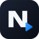
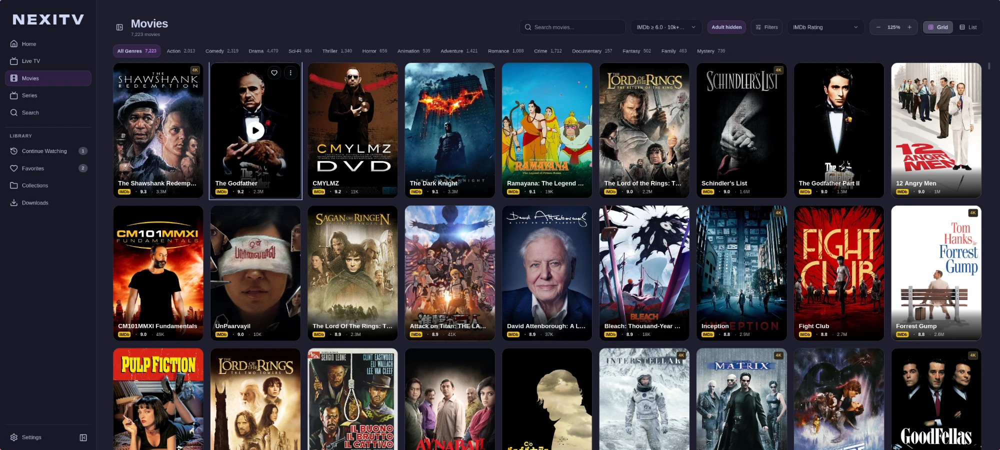
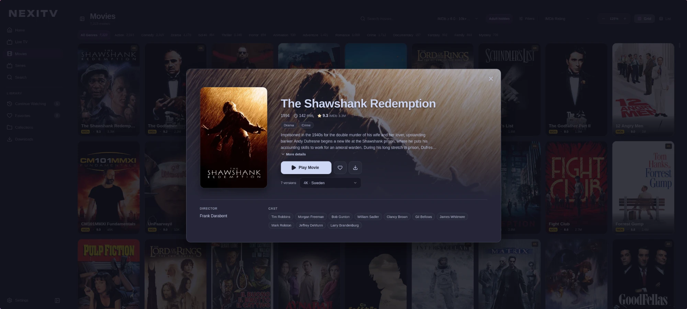
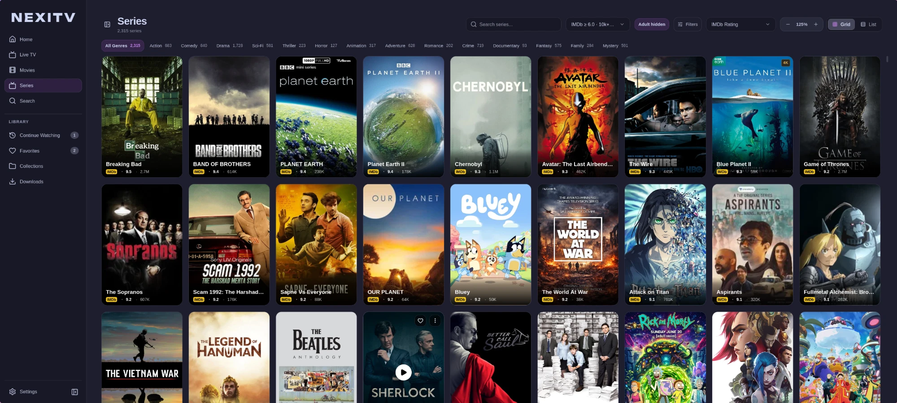
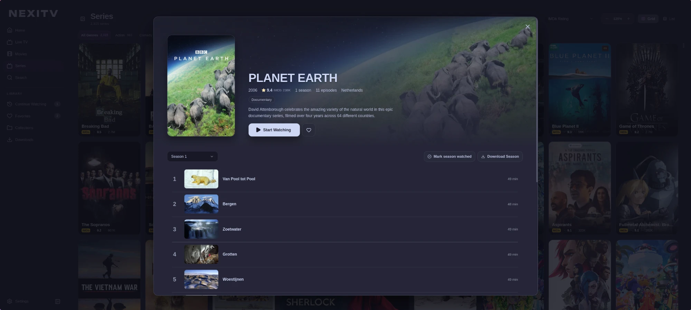

<p align="center">
  
</p>

<h1 align="center">NexiTV</h1>

<p align="center">
  A private, cross-platform IPTV and VOD desktop player for Xtream Codes and
  M3U/M3U8 playlists, with XMLTV EPG and native libmpv playback.
</p>

<p align="center">
  <a href="https://github.com/NexiTask/nexitv/releases/latest"></a>
  <a href="https://github.com/NexiTask/nexitv/actions/workflows/compliance.yml"></a>
  <a href="LICENSE"></a>
  
</p>

<p align="center">
  <strong><a href="https://github.com/NexiTask/nexitv/releases/latest">Download</a></strong>
  · <a href="https://github.com/NexiTask/nexitv/issues">Report an issue</a>
  · <a href=".github/SUPPORT.md">Support</a>
  · <a href=".github/CONTRIBUTING.md">Contribute</a>
</p>

> [!IMPORTANT]
> **Use official sources only.** NexiTV is a free, open-source player. It does
> not sell or provide subscriptions, channels, playlists, or media. Download it
> only from this repository or the official website.

> [!NOTE]
> Bring your own authorized content. NexiTV does not bypass DRM; use recording,
> catch-up, and download features only where you have permission.



## Get started

1. [Download the latest NexiTV release](https://github.com/NexiTask/nexitv/releases/latest) for your desktop platform.
2. Connect an authorized Xtream Codes account or add a local or remote M3U/M3U8 playlist.
3. Browse Live TV, movies, series, and available programme guide data.

NexiTV keeps sources separate at the credential boundary while presenting their
enabled channels, catalogues, categories, and guides in one workspace.

## Features

**Sources and playlists**

- Connect multiple Xtream Codes and M3U/M3U8 sources at the same time.
- Load playlists from local files or remote URLs, with scheduled background refresh.
- Fold duplicate quality tiers (4K, FHD, HD, RAW, HEVC) of the same live channel into a single entry with automatic stream failover.
- Detect playlist XMLTV metadata or configure a per-source XMLTV override.
- Set source-specific user-agent and referrer headers when required.

**Live TV and programme guide**

- Browse provider or XMLTV guide data with now/next information and a timeline grid.
- Search channels, organize categories, and move between channels without leaving playback.
- Correct distorted 16:9 and 4:3 broadcast logos with smart aspect-ratio detection.
- Play supported provider and M3U catch-up/archive programmes.
- Use a dedicated audio-only interface for playlist entries marked as radio.

**Movies, series, and discovery**

- Browse VOD catalogues, seasons, episodes, recently added media, and upcoming releases.
- Search across Live TV, movies, and series; a catalogue page's search box finds only its own kind.
- Enable optional TMDB enrichment for localized posters, backdrops, and descriptions. A provider cover that is only a thumbnail or screenshot is replaced by TMDB's real poster.
- Track upcoming movie premieres and TV broadcasts with a monthly release calendar and live second-by-second countdowns backed by TMDB and TVmaze.

**IMDb ratings and filters**

- Match IMDb ratings and vote counts onto every movie and series from IMDb's free datasets, shown on the cards and the info page, with an IMDb sort. The data refreshes automatically about once a week, or on demand from Settings.
- Cut the noise with quality presets (IMDb 7.0+ with 1k votes, 6.5+ with 5k, 6.0+ with 10k) and a switch that hides titles the provider flags as adult.
- Use the **Filters** panel on Movies and Series: year range, runtime (episode length for series), IMDb rating and votes, genres (include or exclude, using IMDb's genres too), recently added, watch state, 4K only, and IMDb-rated only. Each page remembers its own filters.
- Group the provider's duplicate entries of one title into a single card with the best copy, and switch between the other versions (labelled by quality and country) from the info page. If one version fails to load, the next one opens automatically.
- Set a **Content Filter** in Settings: hide whole countries and keywords from Movies and Series, including cross-listed categories such as "Indian films" filed under another market.

**Playing and tracking**

- Press a card's play button to resume a movie where you stopped, or a series at your current episode or the next unwatched one, without opening the info page.
- Remove a title from Continue Watching with the X on its card, and mark a whole season watched or unwatched from the info page.
- Open a cinematic info page with a full-width backdrop, a poster, facts, genres, plot, version picker, and compact episode rows.

**Native playback**

- Play video in-window through native libmpv rather than browser video decoding.
- Configure GPU hardware decoding, demuxer buffer sizes (50–500 MiB), and automatic playback recovery.
- Apply HDR-to-SDR tone-mapping algorithms (BT.2446a, Filmic, Reinhard, Mobius), real-time color controls, custom aspect ratios, and Side-by-Side 3D-to-2D conversion.
- Customize subtitle styling (font size, color, background, outline, screen offset) and adjust audio/subtitle synchronization delays.
- Skip chapter-marked or IntroDB-detected intros and recaps with on-screen prompts or hands-free auto-skip.
- Auto-play next episodes with an interactive countdown and navigate seasons through the in-player drawer.

**Library and offline use**

- Save favorites, custom collections, watch history, and Continue Watching progress locally.
- Download movies and episodes with multi-threaded background transfers (1–8 parallel queues), pause, resume, retry, and file reveal.
- Record live TV streams directly to the system Downloads folder with sandboxed path validation.

**M3U workspace**

- Edit playlists through structured channel tables or the raw syntax-highlighted document.
- Batch-clean titles, find and replace values, renumber entries, and manage categories.
- Validate playlist syntax and probe stream health in the background without exposing connection secrets.
- Undo and redo edits, recover local drafts, review changes, export copies, and restore saved versions.

**Look and feel**

- Pick a colour theme: Catppuccin (Mocha, Macchiato, Frappé, and Latte for light), Dracula, Nord, Gruvbox, Tokyo Night, Rosé Pine, or Solarized, each with its own accent.
- Choose a grid or list view and a card size from 80% to 200% separately for every section; cards start at 125%.
- Scale the whole interface from 75% to 200% in Settings or with <kbd>Ctrl</kbd> + <kbd>+</kbd> / <kbd>−</kbd> / <kbd>0</kbd>.
- Fold the category sidebar away, hide the window buttons on a tiling desktop, and switch Live TV between the channel grid and the programme guide with one toggle.

**Privacy and personalization**

- Keep passwords and connection secrets in the operating-system credential vault.
- Use NexiTV without a project-operated account, advertising, analytics, or telemetry.
- Choose English, German, Spanish, French, Italian, Dutch, Polish, or Brazilian Portuguese.
- Customize accent, catalogue layout, motion, playback, subtitle, picture, and notification settings.
- Export portable preferences without credentials, playlist URLs, history, favorites, or cached media.
- Check for and install signed NexiTV updater packages from GitHub Releases.

## Product tour

These are screenshots of the NexiTV desktop app running on a real catalogue, in
the Catppuccin Mocha theme with 125% cards. The posters are artwork from TMDB,
shown here only to illustrate the app; no account, source name, or credential
appears in them.

|                                                  Movies with IMDb ratings                                                  |                                                            Movie info page                                                            |
| :------------------------------------------------------------------------------------------------------------------------: | :-----------------------------------------------------------------------------------------------------------------------------------: |
|  |   |
|                                                           Series                                                           |                                                           Series info page                                                            |
|                              |  |

## Download and platform support

NexiTV has no published release yet. Until the first one appears on the
[releases page](https://github.com/NexiTask/nexitv/releases), build it from
source (see [Build from source](#build-from-source)). The build produces the
packages below; a release will also carry a SHA-256 checksum file, an SPDX SBOM,
and build-provenance attestations. Platform trust status remains explicitly
disclosed below.

| Platform            | Packages the build produces          | Important notes                                                                                                                          |
| ------------------- | ------------------------------------ | ---------------------------------------------------------------------------------------------------------------------------------------- |
| Windows x64         | NSIS `.exe`, `.msi`, portable `.zip` | Standalone NSIS and portable packages bundle libmpv.                                                                                     |
| macOS Apple Silicon | `.dmg` (`aarch64`)                   | Bundles its own mpv runtime, nothing else to install. Current builds are ad-hoc signed rather than Developer ID notarized.               |
| macOS Intel         | `.dmg` (`x86_64`)                    | Bundles its own mpv runtime, nothing else to install. Current builds are ad-hoc signed rather than Developer ID notarized.               |
| Linux x64           | `.deb`, `.AppImage`                  | A compatible system libmpv and normal Tauri/WebKit desktop libraries are required. Install `mpv` through your distribution if necessary. |

If installation or playback fails, search the
[existing issues](https://github.com/NexiTask/nexitv/issues) before opening a
new report. Never include credentials, playlist URLs, provider responses, or
real viewing data in an issue.

<details>
<summary><strong>Keyboard shortcuts</strong></summary>

| Area       | Shortcut                                                         | Action                                                         |
| ---------- | ---------------------------------------------------------------- | -------------------------------------------------------------- |
| Navigation | <kbd>Ctrl/Cmd</kbd> + <kbd>1–5</kbd>                             | Open Home, Live TV, TV Guide, Movies, or Series                |
| Navigation | <kbd>Ctrl/Cmd</kbd> + <kbd>K</kbd>                               | Open Search                                                    |
| Navigation | <kbd>Ctrl/Cmd</kbd> + <kbd>\</kbd>                               | Collapse or expand the sidebar                                 |
| Interface  | <kbd>Ctrl/Cmd</kbd> + <kbd>+</kbd> / <kbd>−</kbd> / <kbd>0</kbd> | Zoom the interface in, out, or back to 100%                    |
| Help       | <kbd>?</kbd>                                                     | Show or hide the in-app shortcut guide                         |
| Playback   | <kbd>Space</kbd> or <kbd>K</kbd>                                 | Play or pause                                                  |
| Playback   | <kbd>F</kbd>                                                     | Toggle fullscreen                                              |
| Playback   | <kbd>M</kbd>                                                     | Mute or restore volume                                         |
| Playback   | <kbd>←</kbd> / <kbd>→</kbd>                                      | Seek backward or forward during VOD playback                   |
| Playback   | <kbd>↑</kbd> / <kbd>↓</kbd>                                      | Adjust volume, or change channels when the live drawer is open |
| Playback   | <kbd>Esc</kbd>                                                   | Close the active player menu, drawer, or player                |

</details>

## Technology

| Layer         | Technology                                     |
| ------------- | ---------------------------------------------- |
| Desktop shell | [Tauri 2](https://tauri.app/)                  |
| Interface     | React, TypeScript, Zustand, and TanStack Query |
| Native core   | Rust                                           |
| Playback      | [libmpv](https://mpv.io/)                      |

React owns presentation and client state; Rust owns native playback,
credential storage, filesystem access, downloads, and native cache/network
operations. See [docs/ARCHITECTURE.md](docs/ARCHITECTURE.md) for the full
boundary and repository map.

## Build from source

You will need Node.js 20.19+, npm, Rust, the
[Tauri 2 prerequisites](https://v2.tauri.app/start/prerequisites/), and libmpv
development/runtime files.

```bash
git clone https://github.com/NexiTask/nexitv.git
cd movena
npm install
```

On macOS:

```bash
xcode-select --install
brew install mpv
```

On Windows, install Visual Studio C++ Build Tools and the Windows SDK, then
provision the pinned development copy of mpv:

```powershell
npm run setup:mpv
```

On Linux, install the Tauri prerequisites and your distribution's libmpv
development package. Then start NexiTV:

```bash
npm run dev
```

## Contributing

Contributions are welcome. Before submitting a change:

```bash
npm run check
npm run check:licenses
```

Every commit needs a DCO sign-off created with `git commit -s`. Please read
[Contributing guide](.github/CONTRIBUTING.md),
[docs/ARCHITECTURE.md](docs/ARCHITECTURE.md), and
[docs/DESIGN_SYSTEM.md](docs/DESIGN_SYSTEM.md) before substantial changes.
Project direction is documented in the [roadmap](docs/ROADMAP.md).

## Project information

NexiTV keeps app data local and operates no media proxy or project account.
Read the [privacy documentation](docs/PRIVACY.md) and
[security policy](.github/SECURITY.md) for data handling and private vulnerability
reporting.

NexiTV is a modified version of [Movena](https://github.com/movena-app/movena)
(not the official release, and not endorsed by that project), licensed under
[GPL-3.0-or-later](LICENSE). Packaging and distribution requirements are
documented in [docs/RELEASING.md](docs/RELEASING.md).
See [CHANGELOG.md](CHANGELOG.md) for unreleased and tagged product changes.
Third-party notices and asset provenance are in
[docs/THIRD_PARTY_NOTICES.md](docs/THIRD_PARTY_NOTICES.md),
[THIRD_PARTY_LICENSES.txt](THIRD_PARTY_LICENSES.txt), and
[docs/ASSETS.md](docs/ASSETS.md). See the
[Code of Conduct](.github/CODE_OF_CONDUCT.md) and
[trademark guidance](docs/TRADEMARK.md) for community and branding terms.
